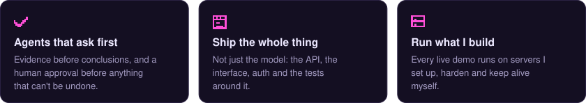
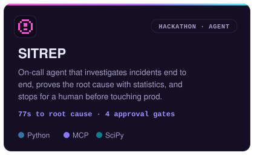
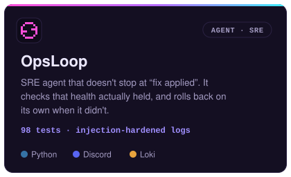
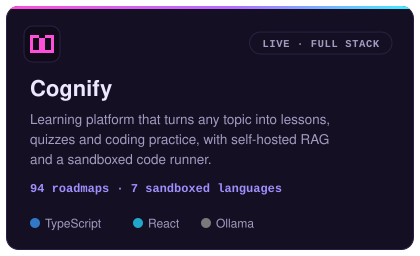
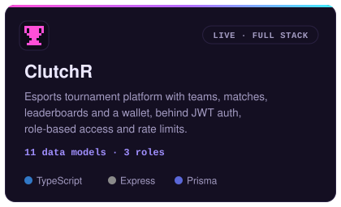
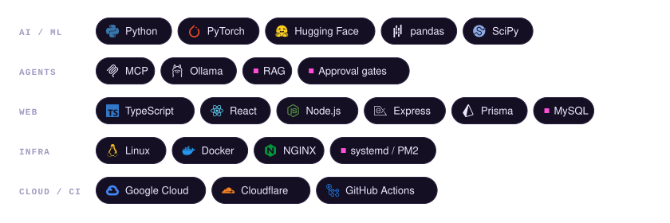

<a href="https://nagarjuna.ourspaces.net/"><picture><source media="(prefers-color-scheme: dark)" srcset="./assets/header-dark.svg"><source media="(prefers-color-scheme: light)" srcset="./assets/header-light.svg"></picture></a>

<a href="https://nagarjuna.ourspaces.net/"><picture><source media="(prefers-color-scheme: dark)" srcset="./assets/btn-portfolio-dark.svg"><source media="(prefers-color-scheme: light)" srcset="./assets/btn-portfolio-light.svg"></picture></a><a href="https://www.linkedin.com/in/goddindla-nagarjuna/"><picture><source media="(prefers-color-scheme: dark)" srcset="./assets/btn-linkedin-dark.svg"><source media="(prefers-color-scheme: light)" srcset="./assets/btn-linkedin-light.svg"></picture></a>

<h3><picture><source media="(prefers-color-scheme: dark)" srcset="./assets/h-about-dark.svg"><source media="(prefers-color-scheme: light)" srcset="./assets/h-about-light.svg"></picture></h3>

<picture><source media="(prefers-color-scheme: dark)" srcset="./assets/about-dark.svg"><source media="(prefers-color-scheme: light)" srcset="./assets/about-light.svg"></picture>

<h3><picture><source media="(prefers-color-scheme: dark)" srcset="./assets/h-work-dark.svg"><source media="(prefers-color-scheme: light)" srcset="./assets/h-work-light.svg"></picture></h3>

<a href="https://github.com/Vectorplayzz/sitrep-incident-commander"><picture><source media="(prefers-color-scheme: dark)" srcset="./assets/card-sitrep-dark.svg"><source media="(prefers-color-scheme: light)" srcset="./assets/card-sitrep-light.svg"></picture></a><a href="https://github.com/Vectorplayzz/devops-failure-recovery-agent"><picture><source media="(prefers-color-scheme: dark)" srcset="./assets/card-opsloop-dark.svg"><source media="(prefers-color-scheme: light)" srcset="./assets/card-opsloop-light.svg"></picture></a>
<a href="https://github.com/Vectorplayzz/cognify"><picture><source media="(prefers-color-scheme: dark)" srcset="./assets/card-cognify-dark.svg"><source media="(prefers-color-scheme: light)" srcset="./assets/card-cognify-light.svg"></picture></a><a href="https://github.com/Vectorplayzz/clutchr"><picture><source media="(prefers-color-scheme: dark)" srcset="./assets/card-clutchr-dark.svg"><source media="(prefers-color-scheme: light)" srcset="./assets/card-clutchr-light.svg"></picture></a>

<a href="https://cognify.ourspaces.net/"><picture><source media="(prefers-color-scheme: dark)" srcset="./assets/btn-cognify-dark.svg"><source media="(prefers-color-scheme: light)" srcset="./assets/btn-cognify-light.svg"></picture></a><a href="https://clutchr.ourspaces.net/"><picture><source media="(prefers-color-scheme: dark)" srcset="./assets/btn-clutchr-dark.svg"><source media="(prefers-color-scheme: light)" srcset="./assets/btn-clutchr-light.svg"></picture></a><a href="https://minimart.ourspaces.net/"><picture><source media="(prefers-color-scheme: dark)" srcset="./assets/btn-minimart-dark.svg"><source media="(prefers-color-scheme: light)" srcset="./assets/btn-minimart-light.svg"></picture></a> 
Also here: <a href="https://github.com/Vectorplayzz/minimart">MiniMart</a>, multi-branch inventory with demand forecasting · <a href="https://github.com/Vectorplayzz/worst-captcha">CAPTCHA Pro</a>, the world's most frustrating CAPTCHA (on purpose)

<h3><picture><source media="(prefers-color-scheme: dark)" srcset="./assets/h-toolbox-dark.svg"><source media="(prefers-color-scheme: light)" srcset="./assets/h-toolbox-light.svg"></picture></h3>

<picture><source media="(prefers-color-scheme: dark)" srcset="./assets/toolbox-dark.svg"><source media="(prefers-color-scheme: light)" srcset="./assets/toolbox-light.svg"></picture>

 

<picture><source media="(prefers-color-scheme: dark)" srcset="https://raw.githubusercontent.com/Vectorplayzz/Vectorplayzz/output/snake-dark.svg"><source media="(prefers-color-scheme: light)" srcset="https://raw.githubusercontent.com/Vectorplayzz/Vectorplayzz/output/snake-light.svg"></picture>
